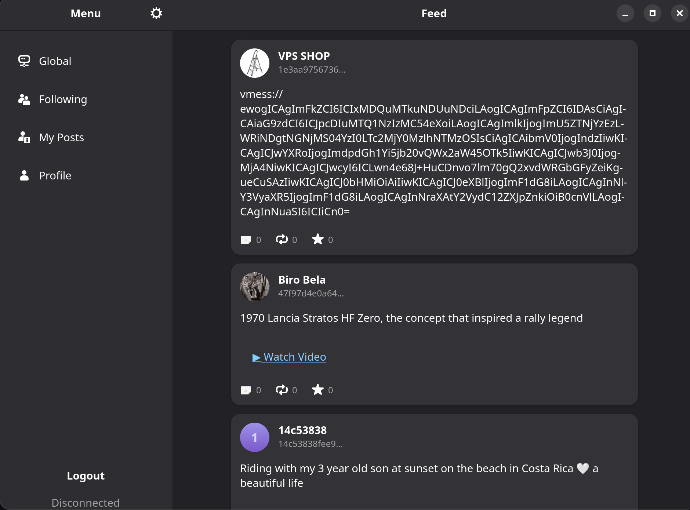

# Gnostr (Under Construction)

Gnostr is a native Linux Nostr client designed specifically for the GNOME Desktop environment. It leverages an adaptive user interface, providing a great experience on both desktop and mobile Linux devices, such as the Librem 5 or PinePhone.

## Features

[](screenshot.png)

*   **Adaptive UI:** Utilizes `Adw.NavigationSplitView` for a sidebar layout on desktop and a navigation stack on mobile, ensuring a consistent and intuitive experience across different screen sizes.
*   **Secure Storage:** Private keys (nsec) are stored securely in the system keyring using `libsecret`, preventing exposure of sensitive data in plain text.
*   **Nostr Protocol:** Connects to relays via WebSockets to fetch and publish events — read and write: post, reply, like (NIP-25), repost (NIP-18), follow (kind-3 contact lists), and profile editing (kind-0), with NIP-01 OK-ack feedback per publish.
*   **Rich Content:** Inline images and video playback (`playbin3` + `gtk4paintablesink`), quote cards for `nostr:` references (NIP-19/NIP-21: npub, note, nevent, naddr long-form articles), thread view with reply trees.
*   **Profiles:** Full NIP-01/24 metadata (banner, bio, website), NIP-05 identity verification, LUD-16 lightning addresses, NIP-39 external identities, NIP-58 badges.
*   **GNOME Integration:** Built with GNOME technologies for seamless integration with the desktop environment.

## Getting Started

### Prerequisites

*   Python 3.11+
*   GTK4, libadwaita-1
*   GStreamer 1.0 with plugins (`playbin3`, `gtk4paintablesink`)
*   pytest, black, flake8 (for development)

### Building

Use Flatpak Builder to build this application.

```bash
flatpak-builder --force-clean --repo=repo build_dir tech.livingonlinux.gnostr.json
flatpak build-bundle repo gnostr.flatpak tech.livingonlinux.gnostr
```

Prebuilt flatpaks are available within the repo for Arm and x86.

### Hardware-Accelerated Video (VA-API)

**No environment variables are required in the default setup.** GStreamer's
`playbin3` auto-detects a working VA-API driver at runtime, and the Flatpak
manifest already grants GPU access (`--device=dri`). You only need to set a
variable when you are making a deliberate choice — hybrid GPUs, an unusual
driver stack, or a software-fallback problem you are diagnosing:

| Situation | What to set |
|---|---|
| Intel integrated (HD/UHD) or AMD on older Mesa: wrong driver picked | `LIBVA_DRIVER_NAME=i965` (Intel Gen7–9), `crocus` (Intel on older Mesa), `radeonsi` (AMD) |
| AMD RDNA2 or newer (RX 5000+) | Nothing — recent Mesa selects the Vulkan video path automatically; do **not** force `radeonsi` |
| NVIDIA | The Flatpak already bundles software decode (`org.freedesktop.Platform.ffmpeg-full`), so video always works; for NVDEC hardware decode install the optional extension `flatpak install flathub org.freedesktop.Platform.VAAPI.nvidia` (no env var) |
| Hybrid graphics (iGPU + dGPU): pin which GPU decodes | `GST_VAAPI_DRM_DEVICE=/dev/dri/renderD128` (iGPU) or `/dev/dri/renderD129` (dGPU) — check with `ls /dev/dri/renderD*` |
| gst-vaapi refuses to load a non-default driver (*from-source / distro install only* — the Flatpak manifest already bakes this in via `--env`) | `GST_VAAPI_ALL_DRIVERS=1` |

Because Gnostr ships as a Flatpak, these must be passed through Flatpak, not your
shell:

```bash
flatpak run --env=GST_VAAPI_DRM_DEVICE=/dev/dri/renderD128 tech.livingonlinux.gnostr
# make it permanent:
flatpak override --user --env=GST_VAAPI_DRM_DEVICE=/dev/dri/renderD128 tech.livingonlinux.gnostr
```

To confirm hardware decode is actually in use, run with
`GST_DEBUG=vaapidecode*:4,avdec_*:4` — you want to see `vaapidecode` selected;
`avdec_h264` means GStreamer fell back to software decoding.

### Running Tests

```bash
# Run with xvfb for headless display
xvfb-run pytest tests/

# Or run without xvfb (if display available)
pytest tests/
```

### Linting

```bash
# Format code
black src/ tests/
isort src/ tests/

# Check linting
flake8 src/ tests/ --max-line-length=120
```

## Contributing

See [CONTRIBUTING.md](CONTRIBUTING.md) for build conventions, the test/lint
gate, and the DOX documentation contract.

## Buy me a beer

If you like this project and would like to support its development:

bc1qkgcg44wxmmjrt5uvnya5g2zqd84pm6mawjp3s

## License

This project is licensed under the MIT License. See the LICENSE file for details.
